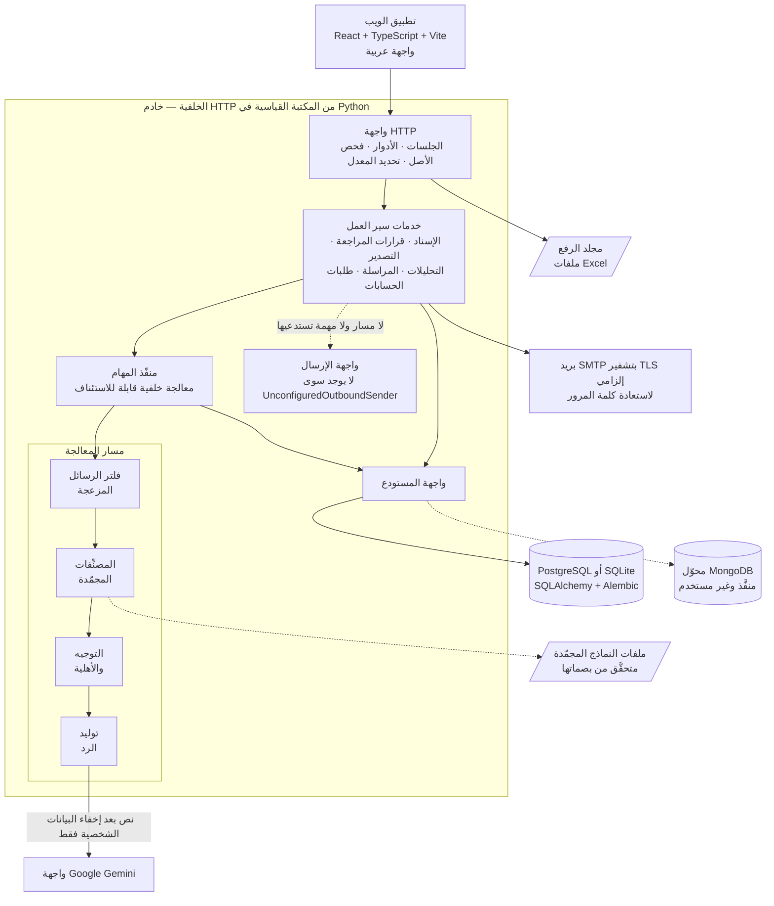
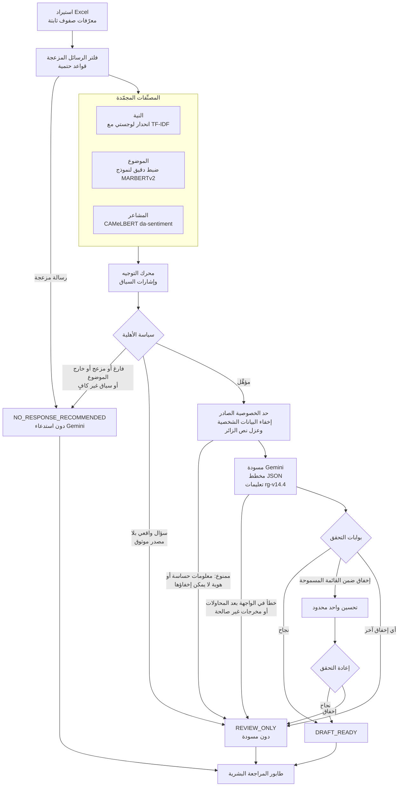
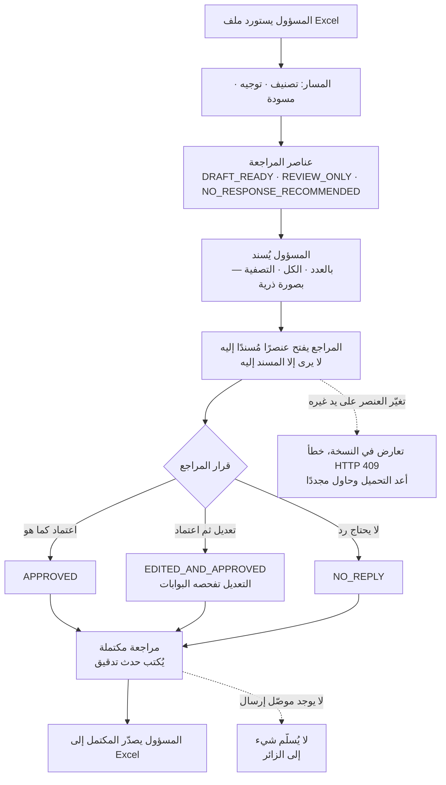
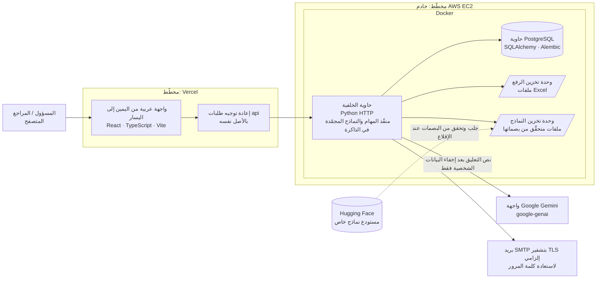

[🇬🇧 English](README.md) | 🇸🇦 **العربية**

<div dir="rtl">

# ذكاء تعليقات الزوار العربية وإدارة الردود

**تصنيف بالذكاء الاصطناعي · مسودات ردود من Gemini · مراجعة بشرية**

نظام بمراجعة بشرية يحوّل تعليقات الزوار العربية إلى عناصر مصنَّفة ومسودات ردود قابلة للمراجعة. لا يرسل شيئًا من تلقاء نفسه.


*وضع المراجعة على بيانات تجريبية اصطناعية: التعليق وتصنيفه ومسودة الرد والقرارات الثلاثة للمراجع.*

> **حالة النشر: لم يُنشر بعد، ولا يوجد رابط تجريبي.** يضم المستودع التطبيق كاملًا مع اختباراته وإعدادات النشر، لكن لا توجد نسخة مستضافة.
> **الرابط التجريبي:** غير متاح حاليًا — لن يُضاف هنا إلا بعد التحقق من نجاح النشر.
>
> **لا يُرسل أي رد إلى الزائر.** ينتج النظام *مسودات* ردود تُراجَع بشريًا. اعتماد المراجع قرار مسجَّل وليس إرسالًا ([التفاصيل](#الاعتماد-لا-يعني-الإرسال)).

هذه **النسخة الهندسية العامة**: هوية محايدة وبيانات اصطناعية فقط، ولا تتضمن بيانات زوار ولا أوزان نماذج ولا بيانات اعتماد. الاختصار «RCS» (نظام تصنيف الردود والرد الذكي) اسم تقني للمستودع فقط، كما في حزمة `src/rcs`.

| لمحة سريعة | |
|---|---|
| **المدخلات** | ملفات Excel فيها تعليقات زوار عربية حرة |
| **المسار** | فلتر الرسائل المزعجة ← ثلاثة مصنِّفات مجمّدة (النية والموضوع والمشاعر) ← توجيه وأهلية ← مسودة Gemini ← تحقق حتمي |
| **القرار البشري** | اعتماد كما هو · تعديل واعتماد · لا يحتاج رد |
| **المخرجات** | قرارات مدقَّقة وملف Excel بالمراجعات المكتملة؛ ولا تُسلَّم أي رسالة |
| **الواجهة** | تطبيق ويب عربي من اليمين إلى اليسار للمسؤولين والمراجعين |
| **التقنيات** | Python · React + TypeScript · PostgreSQL · scikit-learn · PyTorch/Transformers · Google Gemini |
| **الحالة** | منفَّذ ومُختبَر محليًا؛ النشر مخطَّط ولا شيء منشور |

---

- [نظرة عامة](#نظرة-عامة)
- [حالة المشروع](#حالة-المشروع)
- [المشكلة والحل](#المشكلة-والحل)
- [أبرز الميزات](#أبرز-الميزات)
- [البنية المعمارية](#البنية-المعمارية)
- [مسار الذكاء الاصطناعي والتصنيف](#مسار-الذكاء-الاصطناعي-والتصنيف)
- [توليد الردود بواسطة Gemini](#توليد-الردود-بواسطة-gemini)
- [المراجعة البشرية](#المراجعة-البشرية)
- [الأدوار](#الأدوار)
- [التحليلات والتقارير](#التحليلات-والتقارير)
- [التقنيات المستخدمة](#التقنيات-المستخدمة)
- [تقييم النماذج](#تقييم-النماذج)
- [بنية النشر](#بنية-النشر)
- [لقطات الشاشة](#لقطات-الشاشة)
- [الأمن والخصوصية](#الأمن-والخصوصية)
- [الاختبارات](#الاختبارات)
- [القيود](#القيود)
- [التشغيل المحلي](#التشغيل-المحلي)
- [الوثائق](#الوثائق)
- [الترخيص](#الترخيص)

## نظرة عامة

يحوّل النظام ملفات Excel التي تحوي تعليقات الزوار الحرة باللغة العربية (على موقع معجم عربي) إلى ردود **مراجَعة**. يُستورد التعليق، ثم يُفحص للكشف عن الرسائل المزعجة، ويُصنَّف بحسب النية والموضوع والمشاعر، ثم تحدد سياسة حتمية مساره. وإذا كان مؤهلًا فقط، يكتب Gemini **مسودة** رد له، وتفحص كل مسودةً بوابات تحقق حتمية. بعد ذلك يعتمد مراجع بشري المسودة، أو يعدّلها، أو يقرر أن التعليق لا يحتاج ردًا.

النظام أداة مساندة قابلة للتدقيق، والقرار الأخير فيها لإنسان. وليس وكيلًا مستقلًا: لا يملك أدوات، ولا ينفّذ إجراءات بنفسه، ولا يوجد فيه موصّل يستطيع إرسال رسالة.

## حالة المشروع

| الإمكانية | الحالة |
|---|---|
| استيراد Excel بهوية ثابتة للصفوف ومنع التكرار | منفَّذ · مُختبَر |
| فلتر الرسائل المزعجة، والمصنِّفات الثلاثة المجمّدة، والتوجيه، وسياسة الأهلية | منفَّذ · مُختبَر |
| توليد مسودات Gemini، وحدّ الخصوصية الصادر، وبوابات التحقق، والتحسين المحدود | منفَّذ · مُختبَر بعميل Gemini وهمي؛ سلوك Gemini الحي غير مشمول بالاختبارات الآلية |
| سير عمل المسؤول والمراجع، والإسناد، وسجل التدقيق، والتصدير، والتحليلات، والمراسلة | منفَّذ · مُختبَر |
| المصادقة والجلسات وطلبات الحسابات واستعادة كلمة المرور | منفَّذ · مُختبَر |
| قاعدة بيانات PostgreSQL (ترحيلات Alembic) | منفَّذ · مُختبَر (SQLite وPostgreSQL 16) |
| قاعدة بيانات MongoDB | منفَّذ خلف واجهة المستودع نفسها · لم يُستخدم في الإنتاج |
| صورة Docker للخلفية ونقطة دخول تتحقق من بصمات النماذج | جاهز للنشر (الإعدادات في المستودع؛ الصورة غير منشورة) |
| إعداد Vercel للواجهة (إعادة توجيه SPA وقالب وكيل `/api` بالأصل نفسه) | جاهز للنشر (الإعدادات في المستودع؛ غير منشور) |
| خادم AWS EC2 مع PostgreSQL داخل Docker وTLS وخادم وكيل عكسي | **مخطَّط** (لا توجد إعدادات EC2 في المستودع بعد) |
| إرسال الردود المعتمدة فعليًا إلى الزوار | **غير منفَّذ** عمدًا |
| نسخة مستضافة أو رابط تجريبي | **لا يوجد. لا شيء منشور.** ولن يُضاف الرابط التجريبي إلا بعد التحقق من نجاح النشر. |

## المشكلة والحل

**المشكلة.** تصل آلاف التعليقات العربية: شكر، وبلاغات أعطال، وتصحيحات، واقتراحات كلمات، وأسئلة، ورسائل مزعجة. يجب أن تكون الردود حذرة، بلا وعود ولا معلومات مختلَقة، وأن تُحمى بيانات الزوار الشخصية. قراءة كل شيء يدويًا لا تتسع للحجم، وترك نموذج لغوي يرد وحده غير آمن.

**الحل.** مسار مرحلي يفشل بأمان:

1. خطوات حتمية رخيصة تزيل الضوضاء وتحدد *هل* يُسمح بمسودة أصلًا؛
2. نموذج لغوي يكتب مسودة للتعليقات المؤهلة فقط، ولا يرى إلا نصًّا منزوع البيانات الشخصية؛
3. بوابات حتمية ترفض المسودات غير الآمنة، وأي إخفاق يترك العنصر لإنسان **دون مسودة مختلَقة**؛
4. إنسان يتخذ كل قرار نهائي، وكل قرار يُسجَّل في سجل التدقيق.

## أبرز الميزات

| المجال | ما يقدمه |
|---|---|
| **الاستيراد** | قراءة ملفات Excel. معرّف الصف هو `sha256(source_file\|row_index)`؛ ويُتعرَّف على الملف المعاد استيراده ببصمة المحتوى، ويُرفض استخدام اسم ملف سبق استيراده لمحتوى مختلف. وتجري المعالجة على دفعات في الخلفية يمكن استئنافها. |
| **الفرز** | قواعد حتمية لكشف الرسائل المزعجة تحدد ما لا يصل إلى النموذج اللغوي أصلًا. |
| **التصنيف** | ثلاثة مصنِّفات مجمّدة (النية والموضوع والمشاعر) بملفات مثبَّتة النسخة ومتحقَّق من بصماتها. |
| **التوجيه والأهلية** | سياسة حتمية، وليس النموذج، تقرر هل يجوز توليد مسودة. |
| **مسودات Gemini** | إخفاء البيانات الشخصية، وعزل نص الزائر بوصفه غير موثوق، ومخطط JSON للمخرجات، وإعادة محاولة وتحسين واحد محدودان، وفشل آمن. |
| **التحقق** | بوابات حتمية ترفض المسودات غير الآمنة، وأي إخفاق يترك العنصر لإنسان **دون مسودة مختلَقة**. |
| **المراجعة البشرية** | اعتماد كما هو، أو تعديل واعتماد، أو «لا يحتاج رد». تُرفض الكتابة على نسخة قديمة (HTTP 409)، ويُدقَّق كل قرار. |
| **الإدارة** | إسناد ذري بالعدد أو لكل النتائج أو بالتصفية، وتصدير المكتمل فقط إلى Excel، وتحليلات، ومراسلة المراجعين، والموافقة على الحسابات. |
| **الواجهة** | تطبيق ويب عربي من اليمين إلى اليسار بـ React وTypeScript. |
| **الأمن** | كلمات مرور مشفّرة بـ bcrypt، ورموز جلسات واستعادة مخزَّنة مجزَّأة، وفحص الأدوار في الخادم، وتحديد معدل الطلبات، وSMTP بتشفير TLS إلزامي. |

## البنية المعمارية

يعرض المخطط ما هو **منفَّذ فعلًا في هذا المستودع**. أما بنية الاستضافة المخطَّطة فتظهر منفصلة في [بنية النشر](#بنية-النشر).



**كيف تترابط المكوّنات**

1. يتحدث المتصفح مع واجهة HTTP فقط (`src/rcs/review/http_api.py`)، وهي خادم من المكتبة القياسية في Python وليست إطار عمل ويب. ويُفحص كل طلب من حيث الجلسة والدور والأصل.
2. تستدعي الواجهة خدمات سير العمل التي تقرأ وتكتب عبر **واجهة مستودع** واحدة. PostgreSQL (عبر SQLAlchemy وAlembic) هو الافتراضي، وSQLite للتشغيل المحلي والاختبارات. ويوجد محوّل MongoDB ينفّذ الواجهة نفسها لكنه غير مستخدم.
3. يُحفظ الملف المرفوع في مجلد الرفع، ويعالجه منفّذ المهام على دفعات قابلة للاستئناف عبر المسار: فلتر الرسائل المزعجة ← المصنِّفات المجمّدة ← التوجيه والأهلية ← توليد الرد.
4. تُحمَّل ملفات المصنِّفات المجمّدة من مجلد محلي، ويُتحقق منها مقابل قيم SHA-256 في `config/frozen_models_manifest.json`.
5. لا يصل إلى عميل Gemini إلا التعليقات التي اجتازت الأهلية، وبعد إخفاء البيانات الشخصية.
6. تُحفظ قرارات المراجعين مع حدث تدقيق ورقم نسخة متفائل `row_version`.
7. في طبقة الخدمات دالة `dispatch_outbound`، لكن لا يستدعيها أي مسار HTTP ولا أي مهمة خلفية، والصنف الوحيد للإرسال هو `UnconfiguredOutboundSender`. فلا يُسلَّم شيء إلى الزوار.

**هيكل المشروع**

```text
src/rcs/ingest/               استيراد Excel والتنظيف ومعرّفات ثابتة
src/rcs/prefilter/            قواعد حتمية لكشف الرسائل المزعجة
src/rcs/classification/       الاستدلال بالنماذج المجمّدة (النية والموضوع والمشاعر) وإشارات السياق
src/rcs/routing/              محرك التوجيه الحتمي
src/rcs/response_generation/  الأهلية والتعليمات وخدمة Gemini وبوابات التحقق والتحسين
src/rcs/review/               واجهة HTTP والمصادقة وسير العمل والإسناد والتصدير والتحليلات والمستودعات
config/                       الإعدادات وبيان النماذج المجمّدة
migrations/                   ترحيلات Alembic (مخطط PostgreSQL)
web/                          الواجهة (React + TypeScript + Vite)
docker/ · Dockerfile          صورة الخلفية ونقطة الدخول
tests/                        اختبارات pytest
```

## مسار الذكاء الاصطناعي والتصنيف

مسار التصنيف في مخطط واحد:



تصل الصفوف الموسومة `NO_RESPONSE_RECOMMENDED` و`REVIEW_ONLY` إلى طابور المراجعة أيضًا. توصية النظام مجرد اقتراح، ويستطيع المراجع تجاوزها.

### النماذج المجمّدة

| المرحلة | ما تفعله |
|---|---|
| الاستيراد | قراءة الملف، وتنظيف النص، وتعيين معرّفات ثابتة، ومنع التكرار. |
| الفلتر | قواعد حتمية لكشف الرسائل المزعجة. |
| النية (5 فئات) | TF-IDF (كلمات وثنائيات كلمات) + انحدار لوجستي متوازن، بمكتبة scikit-learn. |
| الموضوع (7 فئات) | MARBERTv2 بعد الضبط الدقيق. |
| المشاعر (3 فئات) | CAMeLBERT `bert-base-arabic-camelbert-da-sentiment`، نموذج مدرَّب مسبقًا **دون ضبط دقيق**، ومثبَّت على نسخة محددة. |
| التوجيه | محرك حتمي مع إشارات سياق ليست مخرجات نموذج. |
| الأهلية | سياسة حتمية تقرر هل يجوز استدعاء Gemini. |

**التجميد وإمكانية إعادة الإنتاج.** جُمِّدت المصنِّفات في 2026-08-25. يثبّت البيان `config/frozen_models_manifest.json` نسخة Hugging Face لكل نموذج عام وقيمة SHA-256 لكل ملف. يتحقق `scripts/fetch_frozen_models.py` من هذه البصمات، ويحمّل الإنتاج النماذج من المجلد المحلي الذي يملؤه فقط، ولا يحمّلها أبدًا من فرع متغيّر على المنصة. أُعيد إنتاج درجة التحقق للنموذج المجمّد للنية بدقة تامة (0.31539) عند إعادة تدريبه على جزء التدريب المجمّد (455 صفًا). الأوزان وبيانات التدريب والوسوم **غير** موجودة في هذا المستودع.

## توليد الردود بواسطة Gemini

| البند | القيمة |
|---|---|
| المزوّد والمكتبة | Google Gemini عبر مكتبة Python `google-genai` (تُستورد عند الحاجة) |
| نموذج المسودات | `gemini-3.6-flash` (`AI_SUGGESTION_MODEL_NAME`؛ ويمكن تجاوزه بمتغير البيئة `GEMINI_RESPONSE_MODEL_NAME`) |
| نسخة التعليمات | `rg-v14.4` |
| المخرجات | JSON مهيكل يُتحقق منه بمخطط |
| مهلة المحاولة الواحدة | 20 ثانية |
| إعادة المحاولة | حتى محاولتين إضافيتين (3 محاولات) للأخطاء العابرة فقط؛ تأخير يبدأ بـ 0.5 ثانية ويتضاعف بحد أقصى 4 ثوانٍ |
| المفتاح | `GEMINI_API_KEY` من بيئة التشغيل فقط؛ لا يوجد أبدًا في المستودع أو الصورة |

**متى تكون المسودة مسموحة** (`src/rcs/response_generation/eligibility.py`):

| الحالة | النتيجة |
|---|---|
| نص فارغ أو بلا معنى؛ رسالة مزعجة؛ محتوى شخصي خارج الموضوع؛ مسارات استبعاد تشغيلية؛ سياق غير كافٍ | `NO_RESPONSE_RECOMMENDED`؛ **دون استدعاء Gemini**. الاستبعاد الصادر من النموذج وحده يتطلب تأكيدًا إضافيًا، وإلا انتقل العنصر إلى إنسان بحالة `REVIEW_ONLY`. |
| سؤال يطلب معلومات واقعية وليس معه نص مرجعي موثوق | `REVIEW_ONLY`؛ **دون مسودة**، لأن أي جواب سيكون مختلَقًا. |
| شكر أو ثناء أو دعاء؛ اقتراح؛ شكوى؛ مشكلة تقنية؛ ترشيح لكلمة العام | تُولَّد مسودة. الشكاوى والمشكلات التقنية والترشيحات تُجاب بـ *إقرار بالاستلام* فقط، دون وعود أو ادعاءات عن الحالة. |
| سؤال معه نص مرجعي موثوق | تُولَّد مسودة مبنية على النص المرجعي. |

**حد الخصوصية الصادر.** تُطبَّق الدالة `guard_prompt` على كل نص موجَّه يُجمَّع (الطلب الأول وإعادة المحاولة والتحسين) مباشرة قبل الاستدعاء، فلا يوجد مسار يتجاوزها. تُخفي أرقام الهواتف والبريد الإلكتروني والروابط ومعرّفات التواصل الاجتماعي وسلاسل الأرقام الشبيهة بالهويات والعناوين وأسماء الزوار أو الأشخاص الخاصين. يُحاط التعليق بفاصل يعلن للنموذج أنه بيانات غير موثوقة وليس تعليمات. و**يُمنع الطلب كليًا** (فلا يُجرى أي اتصال خارجي) عند وجود ظروف شخصية حساسة، أو معرّفات بقيت بعد الإخفاء، أو نص لا يحوي سوى هوية. القواعد الحتمية لا تبلغ الكمال؛ والمخاطر المتبقية المقبولة موثّقة في المستودع.

**بوابات التحقق.** يجب أن تجتاز كل مسودة هذه الفحوص الحتمية بالترتيب: شكل المحتوى (غير فارغ، وحدود الطول، ووجود العربية) ← تسرّب مصطلحات داخلية ← بيانات شخصية في المسودة ← عبارات جاهزة عامة ← نبرة المقيِّم ← ادعاء تشغيلي غير مسنود ← نسبة نية الزائر ← الضمائر ← بوابات الادعاءات البنيوية. أول إخفاق هو الحاسم، ويُسجَّل برمز سبب.

**التحسين المحدود.** عند الإخفاق بأحد رموز الأسباب القابلة للتصحيح في قائمة قصيرة مسموحة، تُرسل الخدمة طلب تحسين **واحدًا** يتضمن المسودة المرفوضة وسببها، ثم تتحقق مجددًا. بقية حالات الإخفاق لا تُعاد.

**الإخفاق آمن.** غياب العميل، أو خطأ في الواجهة بعد المحاولات، أو JSON معطوب، أو مسودة ما زالت تخفق في التحقق، كلها تنتهي بـ `REVIEW_ONLY` **دون مسودة**. يبقى الصف ظاهرًا للمراجعين، ويمكن أن تعيد محاولته دورة لاحقة.

**لماذا المراجعة البشرية لازمة.** دقة المصنِّفات منخفضة (انظر [تقييم النماذج](#تقييم-النماذج))؛ والبوابات تلتقط أنماط الأخطاء المعروفة لا كل خطأ ممكن؛ والردود تتحدث باسم مؤسسة. ولم تُقيَّم جودة المسودات بشريًا بعد.

## المراجعة البشرية



**إجراءات المراجع.** أمام المسودة يستطيع المراجع *اعتمادها كما هي*، أو *تعديلها واعتمادها*، أو تحديد أن التعليق *لا يحتاج ردًا*. لا يوجد زر «رفض» مستقل: رفض المسودة يعني تعديلها أو اختيار «لا يحتاج رد». وفي عناصر `REVIEW_ONLY` لا توجد مسودة، فيكتب المراجع الرد (تعديل واعتماد) أو يختار «لا يحتاج رد». ويمر تعديل المراجع عبر فحوص الأمان نفسها. وتستخدم عمليات الحفظ رقم نسخة متفائلًا `row_version`؛ فإذا كان الحفظ على نسخة قديمة أعاد النظام HTTP 409 بدل الكتابة فوق عمل آخر.

### الاعتماد لا يعني الإرسال

| | اعتماد المراجع | الإرسال الفعلي |
|---|---|---|
| ما هو | قرار مسجَّل (`APPROVED` أو `EDITED_AND_APPROVED` أو `NO_REPLY`) مع حدث تدقيق | نشر رد للزائر |
| هل هو منفَّذ | **نعم** | **لا** |
| السبب | سير المراجعة هو جوهر المنتج | لا توجد واجهة موثّقة للكتابة على تعليقات الزوار. لا يحوي `src/rcs/review/outbound.py` سوى `UnconfiguredOutboundSender` الذي يعيد `CONNECTOR_NOT_CONFIGURED`. |

اسما الإجراءين الداخليين `SEND_AS_IS` و`EDIT_AND_SEND`، ومساراً الطلب `/send-as-is` و`/edit-and-send`، تسميات قديمة؛ فهي **تسجّل قرار المراجع فقط**. وفي طبقة الخدمات دالة `dispatch_outbound` وفي جدول الحالات مسار `dispatch → SENDING → SENT` لموصّل مستقبلي، لكن لا يستدعيهما أي مسار HTTP ولا أي مهمة خلفية، ولا يوجد مرسِل حقيقي موصول، فلا يوجد أي مسار برمجي يُسلّم شيئًا. وتغادر الردود المعتمدة النظام فقط عبر ملف Excel للمراجعات المكتملة يستخدمه شخص.

## الأدوار

| | المسؤول (ADMIN) | المراجع (REVIEWER) |
|---|---|---|
| استيراد الملفات | نعم | لا |
| الإسناد (بالعدد / الكل / التصفية، بصورة ذرية) | نعم | لا |
| العناصر المرئية | الكل | **المسندة إليه فقط** (يُفرض في الخادم) |
| الاعتماد والتعديل وتحديد «لا يحتاج رد» | لا | نعم |
| تصدير المراجعات المكتملة | نعم (المكتمل فقط) | لا |
| التحليلات | نعم | لا |
| مراسلة المراجعين | نعم | يستقبلون |
| الموافقة على طلبات الحسابات أو رفضها | نعم | لا |

تُطلب الحسابات الجديدة عبر نموذج عام، ولا تصبح صالحة للاستخدام إلا بعد موافقة مسؤول. ولا يُؤخذ الدور من محتوى الطلب أبدًا.

## التحليلات والتقارير

يحصل المسؤولون على صفحة تحليلات للقراءة فقط، تُحسب من حقول محفوظة أصلًا مع كل عنصر مراجعة (وقت الاستيراد، ووقت المراجعة، وإجراء المراجع، والحالة، والأولوية، والنية، والموضوع، والمشاعر، والمراجع). ولا تغيّر شيئًا في سير العمل.

- **الفترة:** اليوم، أو آخر 7 أيام، أو هذا الشهر، أو نطاق مخصص.
- **الحجم:** التعليقات الواردة وإجمالي المراجعات البشرية في الفترة، ومتوسط زمن المراجعة.
- **نتائج المراجعة:** عدد المسودات المعتمدة كما هي، والمعدّلة ثم المعتمدة، والمحدَّدة «لا يحتاج رد»، مع نسبها. وهي تصف كيف استخدم المراجعون المسودات، و**ليست** تقييمًا للمراجعين.
- **الاتجاه:** الوارد مقابل المراجَع عبر الزمن.
- **التوزيع:** التعليقات الواردة بحسب النية، وبحسب الموضوع، وبحسب المشاعر. كل توزيع مستقل، وليس جدولًا متقاطعًا.
- **الأعمال المتراكمة:** التعليقات بانتظار المراجعة، وذات الأولوية العاجلة، والمتأخرة (بانتظار أكثر من 7 أيام).
- **تقدم المراجعين:** المسند والمكتمل والمتبقي لكل مراجع، في لوحة المسؤول.
- **التقارير:** يصدّر المسؤول المراجعات المكتملة (المكتملة فقط) إلى Excel.

## التقنيات المستخدمة

| المجال | التقنية |
|---|---|
| الواجهة | React 18 وTypeScript وVite، بواجهة عربية من اليمين إلى اليسار |
| الخلفية | Python 3.13، وخادم HTTP من المكتبة القياسية، وPydantic |
| التخزين | PostgreSQL (الافتراضي) عبر SQLAlchemy 2 وAlembic؛ وSQLite للتشغيل المحلي والاختبارات؛ ومحوّل MongoDB (غير مستخدم) |
| التصنيف | scikit-learn (TF-IDF وانحدار لوجستي) وPyTorch وTransformers (MARBERTv2 وCAMeLBERT) |
| مسودات الردود | Google Gemini عبر `google-genai` |
| التغليف | Docker (`python:3.13-slim`، وPyTorch لوحدة المعالجة المركزية فقط، ومستخدم غير جذر، وفحص صحة) |
| الاستضافة المقصودة | Vercel (الواجهة) وAWS EC2 (الخلفية وPostgreSQL داخل Docker) — مخطَّط |
| تخزين النماذج | مستودع Hugging Face خاص |
| الاختبارات | pytest وVitest ورحلات متصفح مبرمجة بـ Playwright |

## تقييم النماذج

> يقيس هذا القسم أداء **المصنِّفات المجمّدة الثلاثة** على بيانات محجوزة للاختبار. وهو لا علاقة له بنتائج اختبارات البرمجيات في [الاختبارات](#الاختبارات): فنجاح آلاف الاختبارات لا يقول شيئًا عن دقة التصنيف.

قُيِّم كل مصنِّف مرة واحدة على **مجموعة اختبار مختومة من 75 صفًا، قابل منها للتقييم 68** (6 صفوف سياقها غير كافٍ وصف واحد بلا وسم)، بعد تجميد النماذج. استُخدم 455 صفًا للتدريب و108 للتحقق واختيار النموذج. البيانات مقيَّدة وغير موزَّعة.

| المهمة | النموذج | macro-F1 في التحقق | macro-F1 في الاختبار | الدقة في الاختبار | دقة فئة الأغلبية |
|---|---|---:|---:|---:|---:|
| النية | TF-IDF + انحدار لوجستي | 0.315 | 0.245 | 0.412 | 0.485 (SPAM) |
| الموضوع | MARBERTv2 مضبوط | 0.402 | 0.161 | 0.368 | 0.412 (OFF_TOPIC_PERSONAL) |
| المشاعر | CAMeLBERT da-sentiment (مدرَّب مسبقًا دون ضبط دقيق) | 0.515 | 0.364 | 0.485 | 0.574 (NEUTRAL) |

*رُوجعت الأرقام مقابل سجل الاختيار المجمّد وملفات تقارير الاختبار الثلاثة.*

**كيف تُقرأ هذه الأرقام بأمانة**

- دقة المصنِّفات الثلاثة **عند مستوى فئة الأغلبية أو دونه**، وقيمة macro-F1 في الاختبار أقل منها في التحقق في المهام كلها.
- ومع 68 صفًا فقط وفئات عدة فيها من صفر إلى خمسة أمثلة، تكون الأرقام على مستوى الفئة شديدة التذبذب.
- لذلك تُستخدم المصنِّفات لـ**توجيه العمل وترتيب أولوياته لإنسان**، لا لاتخاذ قرار ولا لإرسال أي شيء.
- **لم يقيّم بشر مسودات Gemini**، فلا يُدّعى لها أي رقم جودة.
- ولا يُدّعى أي مستوى دقة يتجاوز الجدول أعلاه.

## بنية النشر

**لم يُنشر التطبيق.** يصف المخطط والجدول أدناه البنية *المخطَّطة*، ويفصلان بين الموجود في المستودع وما لم يوجد بعد.



| المكوّن | الهدف | الحالة |
|---|---|---|
| الواجهة (React + TypeScript + Vite) | Vercel | جاهزة للنشر: يوجد `web/vercel.json` وقالب وكيل بالأصل نفسه. غير منشورة. |
| الواجهة البرمجية للخلفية (Python) | حاوية Docker على AWS EC2 | تعريف الصورة جاهز (`Dockerfile` و`docker/entrypoint.sh` وفحص الصحة `/api/health`). خادم EC2: **مخطَّط**. |
| قاعدة البيانات | PostgreSQL في حاوية Docker على خادم EC2 نفسه، وبياناتها في وحدة تخزين دائمة | المخطط والترحيلات جاهزان. أما الحاوية ووحدة التخزين والنسخ الاحتياطي وتجهيز EC2 فـ**مخطَّطة**؛ ولا يوجد في المستودع ملف compose ولا قالب EC2 بعد. |
| ملفات النماذج | مستودع Hugging Face خاص، تُجلب وتُتحقق عند إقلاع الحاوية | الجلب والتحقق من البصمات منفَّذان؛ والمستودع مثبَّت في البيان. |
| مسودات الردود | واجهة Google Gemini | منفَّذة؛ تحتاج `GEMINI_API_KEY` وقت التشغيل. |
| الملفات المرفوعة | وحدة تخزين دائمة (`RCS_UPLOAD_DIR`) | منفَّذة. |
| نسخة تجريبية حية | — | **لا يوجد.** لن يُضاف رابط إلا بعد نجاح النشر. |

ويضم المستودع أيضًا بدائل: `render.yaml` (خلفية بذاكرة 2 غيغابايت وقرص دائم) و`Dockerfile.demo` / `render.demo.yaml` لوضع تجريبي بلا نماذج. ولم يُنشر أي منها.

التحصين المخطَّط قبل أي نشر حقيقي: TLS أمام الواجهة البرمجية، وجعل حاوية الخلفية قابلة للوصول عبر الخادم الوكيل العكسي فقط، وعدم كشف PostgreSQL للإنترنت، وتمرير الأسرار متغيرات بيئة وقت التشغيل فقط، ونسخ احتياطية لقاعدة البيانات. انظر [ملاحظات النشر في الإنتاج](docs/PRODUCTION_DEPLOYMENT.md).

## لقطات الشاشة

جميع لقطات الشاشة مبنية على **بيانات اصطناعية**، ولا تحوي تعليقات زوار ولا بيانات اعتماد ولا معلومات شخصية. **لا تعرض أي منها نتائج إنتاجية:** فالصفوف مختلَقة ومحمَّلة مسبقًا لأغراض العرض، والتصنيفات والمسودات الظاهرة نصوص تجريبية جاهزة وليست مخرجات المصنِّفات المجمّدة ولا Gemini.

| | |
|---|---|
| <br/>**١ · تسجيل الدخول** — بكلمة مرور؛ ينشئ المسؤول الحسابات أو يوافق على الطلبات | <br/>**٢ · الرئيسية للمسؤول** — الإجماليات وتقدم المراجعين وملخص الطابور |
| <br/>**٣ · الإسناد** — تصفية ثم إسناد بالعدد أو لكل النتائج أو بالتحديد | <br/>**٤ · طابور المراجع** — لا يرى المراجع إلا ما أُسند إليه |
| <br/>**٥ · وضع المراجعة** — التعليق والتصنيف والمسودة والقرارات الثلاثة | <br/>**٦ · المراجعات المكتملة** — القرارات النهائية الجاهزة للتصدير |
| <br/>**٧ · الرسائل** — مراسلة المسؤول والمراجعين | |

## الأمن والخصوصية

تعليقات الزوار بيانات شخصية، ولذلك يفترض التصميم أن مزوّد النموذج والمستودع يجب ألا يطّلعا عليها.

| الضابط | أين يُفرض |
|---|---|
| كلمات المرور | bcrypt |
| الجلسات | في الخادم؛ لا يُخزَّن سوى تجزئة الرمز |
| رموز الاستعادة | مجزَّأة وتُستخدم مرة واحدة؛ SMTP بتشفير TLS إلزامي |
| الأدوار وعزل المراجع | فحوص في الخادم على كل نقطة نهاية |
| فحص الأصل ونوع المحتوى وتحديد المعدل | طبقة HTTP |
| الكتابة على نسخة قديمة | رقم نسخة متفائل `row_version`، وHTTP 409 |
| البيانات المرسلة إلى Gemini | بعد إخفاء البيانات الشخصية، ونص الزائر معزول بفاصل |
| الأسرار | بيئة التشغيل فقط؛ الاختبارات لا تقرأ `.env` وتُخفي الأسرار من مخرجاتها |
| محتوى المستودع | لا بيانات زوار ولا قواعد بيانات ولا أوزان نماذج ولا بيانات اعتماد؛ ويُجرى فحص الأسرار قبل النشر |

مزيد من التفاصيل: [ملاحظات الأمن](SECURITY.md) · [docs/SECURITY_AND_PRIVACY.md](docs/SECURITY_AND_PRIVACY.md).

## الاختبارات

تتحقق اختبارات البرمجيات من أن الشيفرة تعمل كما صُمِّمت. وهي **لا** تقيس دقة المصنِّفات؛ لذلك انظر [تقييم النماذج](#تقييم-النماذج).

**النتائج المتحقَّق منها** (نُفِّذت محليًا؛ الأعداد من آخر تشغيل كامل):

| المجموعة | النتيجة |
|---|---|
| pytest للخلفية، SQLite | 3168 ناجحًا و30 متخطًّى (النسخة الخاصة) |
| pytest للخلفية، PostgreSQL 16 | 3165 ناجحًا و33 متخطًّى (النسخة الخاصة) |
| pytest للخلفية، النسخة العامة | 3040 ناجحًا و158 متخطًّى (الاختبارات التي تحتاج ملفات خاصة تُتخطى مع ذكر السبب) |
| Vitest للواجهة | 253 ناجحًا |
| TypeScript | `tsc --noEmit` بلا أخطاء |
| رحلات المتصفح | رحلات مبرمجة للمسؤول والمراجع على بيانات اصطناعية |

استُبدل Gemini بعميل **وهمي** في الاختبارات الآلية. والاختبارات المتخطاة تحتاج ملفات خاصة أو خدمات غائبة عمدًا. وقد كشف تشغيل الاختبارات على PostgreSQL عيبًا حقيقيًا وأُصلح: استعلام الإسناد كان يتجاهل `LIMIT` على PostgreSQL.

## القيود

- دقة المصنِّفات محدودة وأحيانًا دون مستوى فئة الأغلبية، والوسوم قليلة وغير متسقة تمامًا. الخطوة التالية المخطَّطة: مزيد من الوسوم المتسقة ومراجعة بالتعلم النشط.
- لم يقيّم بشر جودة مسودات الردود؛ وسلوك Gemini الحي غير مشمول بالاختبارات الآلية.
- لا يوجد موصّل إرسال، فلا تُرسل الردود المعتمدة إلى أي جهة.
- لم يُنشر النظام، ولم تُجرَ عليه اختبارات حمل، ولم يُشغَّل على حركة حقيقية. وبنية EC2 مع PostgreSQL داخل Docker خطة فقط.
- دعم MongoDB موجود في الشيفرة لكنه لم يُستخدم في الإنتاج.
- العربية فقط. والردود مسودات بنبرة مؤسسة واحدة وسياساتها.

## التشغيل المحلي

```bash
python3.13 -m venv .venv && source .venv/bin/activate
pip install --index-url https://download.pytorch.org/whl/cpu torch && pip install -r requirements.txt
cp .env.example .env                                   # للتطوير المحلي فقط؛ لا تُودِعه في Git
python examples/make_synthetic_data.py && python examples/run_synthetic_evaluation.py   # التدريب والتقييم على بيانات اصطناعية
python scripts/manage_users.py create --email admin@example.invalid --role ADMIN --name "Admin"
python scripts/serve_reviewer_api.py                   # http://127.0.0.1:8765 ، SQLite محلية
cd web && npm ci && npm run dev                        # http://localhost:5173
```

الاختبارات: `python -m pytest -q -rs tests` · `cd web && npm test && npx tsc --noEmit && npm run build`.

الأمر `python scripts/serve_reviewer_api.py --seed` يحمّل صفوفًا تجريبية اصطناعية. ويوجد وضع تجريبي بلا نماذج موصوف في [docs/DEMO_MODE.md](docs/DEMO_MODE.md).

## الوثائق

| الموضوع | الوثيقة |
|---|---|
| البنية المعمارية | [docs/ARCHITECTURE.md](docs/ARCHITECTURE.md) |
| مسار الذكاء الاصطناعي | [docs/AI_PIPELINE.md](docs/AI_PIPELINE.md) |
| المراجعة البشرية | [docs/HUMAN_IN_THE_LOOP.md](docs/HUMAN_IN_THE_LOOP.md) |
| تقييم النماذج | [docs/ML_EVALUATION.md](docs/ML_EVALUATION.md) |
| الأمن والخصوصية | [docs/SECURITY_AND_PRIVACY.md](docs/SECURITY_AND_PRIVACY.md) · [SECURITY.md](SECURITY.md) |
| الاختبارات | [docs/TESTING.md](docs/TESTING.md) |
| النشر في الإنتاج | [docs/PRODUCTION_DEPLOYMENT.md](docs/PRODUCTION_DEPLOYMENT.md) |
| ملفات النماذج والوصول إلى البيانات | [docs/ARTIFACTS_AND_DATA_ACCESS.md](docs/ARTIFACTS_AND_DATA_ACCESS.md) |
| الوضع التجريبي (بلا أوزان ولا استدعاءات نموذج لغوي) | [docs/DEMO_MODE.md](docs/DEMO_MODE.md) · [docs/DEPLOY_DEMO.md](docs/DEPLOY_DEMO.md) |
| التخزين · المصادقة · استعادة كلمة المرور | [docs/persistence.md](docs/persistence.md) · [docs/authentication.md](docs/authentication.md) · [docs/password_reset.md](docs/password_reset.md) |

الوثائق التفصيلية مكتوبة بالإنجليزية.

## الترخيص

لم يُختر ترخيص بعد؛ وإلى أن يُضاف ترخيص تبقى جميع الحقوق محفوظة. المكوّنات الخارجية: [THIRD_PARTY_NOTICES.md](THIRD_PARTY_NOTICES.md).

</div>

