[🇸🇦 العربية](README.ar.md) | 🇬🇧 **English**

# Arabic Visitor Feedback Intelligence & Response Management

**AI-Powered Classification · Gemini Response Drafting · Human Review**

A human-in-the-loop system that turns Arabic visitor comments into classified, reviewable draft replies. It never sends anything on its own.

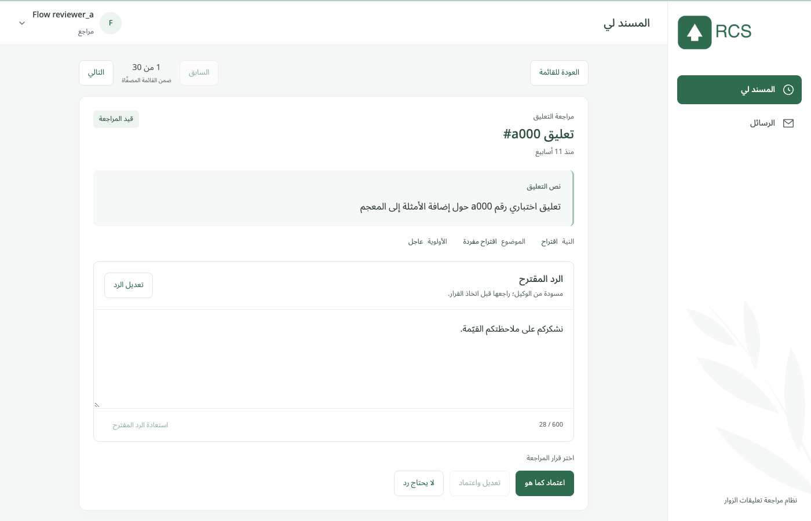
*Review mode on synthetic demo data: the comment, its classification, the draft reply and the three reviewer decisions.*

> **Status: not deployed, no live demo yet.** The repository contains the full implementation, its tests and deployment configuration, but no hosted instance exists.
> **Live demo:** _not available_ — a link will be added here only after a deployment has been verified.
>
> **Nothing is ever sent to a visitor.** The system produces *draft* replies for human review. Reviewer approval is a recorded decision, not message delivery ([details](#approval-is-not-delivery)).

This is the **public engineering edition**: neutral branding and synthetic data only; no visitor data, model weights or credentials are included. "RCS" (Response Classification & Smart-reply System) is only the repository's technical abbreviation, as in the `src/rcs` package.

| At a glance | |
|---|---|
| **Input** | Excel exports of free-text Arabic visitor comments |
| **Pipeline** | spam prefilter → three frozen classifiers (intent, topic, sentiment) → routing and eligibility → Gemini draft → deterministic validation |
| **Human decision** | approve as-is · edit and approve · no reply needed |
| **Output** | audited decisions and a completed-reviews Excel export; no message is delivered |
| **Interface** | Arabic right-to-left web app for admins and reviewers |
| **Stack** | Python · React + TypeScript · PostgreSQL · scikit-learn · PyTorch/Transformers · Google Gemini |
| **State** | Implemented and tested locally; deployment planned, nothing live |

---

- [Project overview](#project-overview)
- [Project status](#project-status)
- [Problem and solution](#problem-and-solution)
- [Key features](#key-features)
- [Architecture](#architecture)
- [AI/ML pipeline](#aiml-pipeline)
- [Gemini response generation](#gemini-response-generation)
- [Human-in-the-loop review](#human-in-the-loop-review)
- [Roles](#roles)
- [Analytics and reporting](#analytics-and-reporting)
- [Tech stack](#tech-stack)
- [Skills demonstrated](#skills-demonstrated)
- [Model evaluation](#model-evaluation)
- [Deployment architecture](#deployment-architecture)
- [Screenshots](#screenshots)
- [Security and privacy](#security-and-privacy)
- [Testing](#testing)
- [Limitations](#limitations)
- [Local setup](#local-setup)
- [Documentation](#documentation)
- [License](#license)

## Project overview

The system turns Excel exports of free-text Arabic visitor comments (for an Arabic dictionary website) into **reviewed** replies. A comment is imported, screened for spam, classified by intent, topic and sentiment, and routed by a deterministic policy. Only if it is eligible does Gemini write a **draft** reply, and deterministic validation gates check every draft. A human reviewer then approves it, edits it, or marks the comment as needing no reply.

It is an assistive, auditable workflow with a human decision at the end. It is not an autonomous agent: it has no tools, takes no actions on its own, and has no connector that can send a message.

## Project status

| Capability | Status |
|---|---|
| Excel import with stable row identity and de-duplication | Implemented · Tested |
| Spam prefilter, three frozen classifiers, routing, eligibility policy | Implemented · Tested |
| Gemini draft generation, outbound privacy boundary, validation gates, bounded refinement | Implemented · Tested with a mocked Gemini client; live Gemini behaviour is not covered by the automated suite |
| Admin and reviewer workflow, assignment, audit trail, export, analytics, messaging | Implemented · Tested |
| Authentication, sessions, account requests, password reset | Implemented · Tested |
| PostgreSQL persistence (Alembic migrations) | Implemented · Tested (SQLite and PostgreSQL 16) |
| MongoDB persistence | Implemented behind the same repository contract · never used in production |
| Backend Docker image, entrypoint with checksum-verified model fetch | Deployment-ready (config in repo; image not yet published) |
| Frontend Vercel configuration (SPA fallback, same-origin API proxy template) | Deployment-ready (config in repo; not deployed) |
| AWS EC2 host with PostgreSQL in Docker, TLS and reverse proxy | **Planned** (no EC2 configuration exists in the repo yet) |
| Real outbound delivery of approved replies | **Not implemented** by design |
| Hosted instance / live demo | **None. Nothing is Live.** The demo link will be added here only after a deployment has been verified. |

## Problem and solution

**Problem.** Thousands of Arabic comments arrive: thanks, bug reports, corrections, word suggestions, questions and spam. Replies have to be careful, with no promises and no invented facts, and visitors' personal data has to be protected. Reading everything by hand does not scale, and letting a language model reply on its own is unsafe.

**Solution.** A staged pipeline that fails closed:

1. cheap deterministic steps remove noise and decide *whether* a draft is allowed at all;
2. a language model drafts only for eligible comments, and sees only redacted text;
3. deterministic gates reject unsafe drafts, and any failure leaves the item for a human with **no invented draft**;
4. a person makes every final decision, and every decision is audited.

## Key features

| Area | What it does |
|---|---|
| **Import** | Reads Excel workbooks. Row ids are `sha256(source_file\|row_index)`; a re-imported file is recognised by content fingerprint, and a filename reused for different content is refused. Processing runs in resumable background batches. |
| **Screening** | Deterministic spam rules decide which comments never reach the language model. |
| **Classification** | Three frozen classifiers (intent, topic, sentiment) with pinned, checksum-verified artifacts. |
| **Routing and eligibility** | A deterministic policy, not the model, decides whether a draft may be generated. |
| **Gemini drafting** | PII masking, untrusted-comment delimiting, JSON output schema, bounded retries and one bounded refinement, fail-closed fallback. |
| **Validation** | Deterministic gates reject unsafe drafts; any failure leaves the item for a human **with no invented draft**. |
| **Human review** | Approve as-is, edit and approve, or no reply needed. Stale edits are rejected (HTTP 409) and every decision is audited. |
| **Administration** | Atomic assignment by count, all, or filter; completed-only Excel export; analytics; reviewer messaging; account approval. |
| **Interface** | Arabic right-to-left React + TypeScript web app. |
| **Security** | bcrypt passwords, hashed session and reset tokens, server-side role checks, rate limits, SMTP over mandatory TLS. |

## Architecture

The diagram shows what is **implemented in this repository**. The planned hosting topology is shown separately under [Deployment architecture](#deployment-architecture).

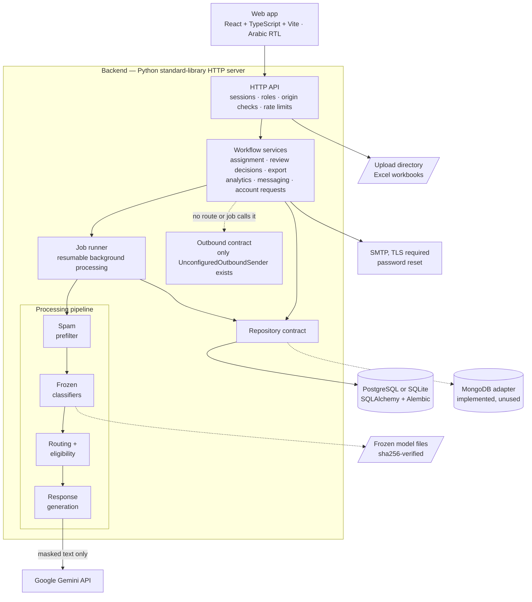

**How it fits together**

1. The browser talks only to the HTTP API (`src/rcs/review/http_api.py`), a Python standard-library server rather than a web framework. Every request is checked for session, role and origin.
2. The API calls workflow services, which read and write through one **repository contract**. PostgreSQL (via SQLAlchemy and Alembic) is the default; SQLite is used locally and in tests. A MongoDB adapter implements the same contract but is not used.
3. An uploaded workbook is stored in the upload directory, and the job runner processes it in resumable batches through the pipeline: prefilter → frozen classifiers → routing and eligibility → response generation.
4. The frozen classifier files are loaded from a local directory and checked against SHA-256 values in `config/frozen_models_manifest.json`.
5. Only comments that pass eligibility reach the Gemini client, and only after PII masking.
6. Reviewer decisions are saved with an audit event and an optimistic `row_version`.
7. The service layer has a `dispatch_outbound` method, but no HTTP route or background job calls it, and the only sender class is `UnconfiguredOutboundSender`. Nothing is delivered to visitors.

**Project layout**

```text
src/rcs/ingest/               Excel import, cleaning, stable ids
src/rcs/prefilter/            deterministic spam rules
src/rcs/classification/       frozen inference (intent, topic, sentiment), context signals
src/rcs/routing/              deterministic routing engine
src/rcs/response_generation/  eligibility, prompt, Gemini service, validation gates, refinement
src/rcs/review/               HTTP API, auth, workflow, assignment, export, analytics, repositories
config/                       settings, frozen model manifest
migrations/                   Alembic (PostgreSQL schema)
web/                          React + TypeScript + Vite UI
docker/ · Dockerfile          backend image and entrypoint
tests/                        pytest suite
```

## AI/ML pipeline

The classification pipeline in one view:

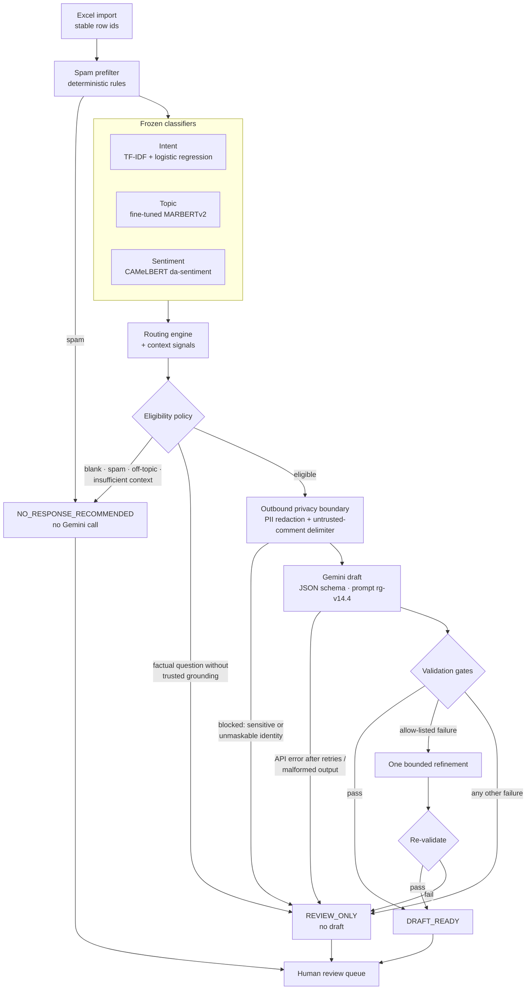

Rows marked `NO_RESPONSE_RECOMMENDED` and `REVIEW_ONLY` still reach the review queue. The model's recommendation is advice, and a reviewer can override it.

### Frozen ML models

| Stage | What it does |
|---|---|
| Import | Reads the workbook, cleans text, assigns stable ids, de-duplicates. |
| Prefilter | Deterministic spam rules. |
| Intent (5 labels) | TF-IDF (word 1–2-grams) + balanced logistic regression, scikit-learn. |
| Topic (7 labels) | MARBERTv2, fine-tuned. |
| Sentiment (3 labels) | CAMeLBERT `bert-base-arabic-camelbert-da-sentiment`, pretrained, **not fine-tuned**, pinned to an exact revision. |
| Routing | Deterministic engine plus context signals, which are not model output. |
| Eligibility | Deterministic policy; decides whether Gemini may be called. |

**Frozen artifacts and reproducibility.** The classifiers were frozen on 2026-08-25. The manifest in `config/frozen_models_manifest.json` pins a Hugging Face revision for each public model and a SHA-256 for every file. `scripts/fetch_frozen_models.py` verifies those hashes, and production loads models only from the local directory it fills, never from a floating branch on the Hub. The frozen intent model's validation score was reproduced exactly (0.31539) when it was re-fitted on the frozen 455-row training split. Weights, training data and labels are **not** in this repository.

## Gemini response generation

| Item | Value |
|---|---|
| Provider / SDK | Google Gemini via the `google-genai` Python SDK (imported lazily) |
| Draft model | `gemini-3.6-flash` (`AI_SUGGESTION_MODEL_NAME`; override with the `GEMINI_RESPONSE_MODEL_NAME` environment variable) |
| Prompt version | `rg-v14.4` |
| Output | Structured JSON, validated against a schema |
| Per-attempt timeout | 20 s |
| Retries | Up to 2 retries (3 attempts) for transient errors only; backoff 0.5 s doubling, capped at 4 s |
| Key | `GEMINI_API_KEY` from the runtime environment only; never in the repository or the image |

**When a draft is eligible** (`src/rcs/response_generation/eligibility.py`):

| Situation | Outcome |
|---|---|
| Blank or meaningless text; spam; off-topic personal content; operational-exclude routes; insufficient context | `NO_RESPONSE_RECOMMENDED`; **no Gemini call**. A model-only exclusion must be corroborated; otherwise the item goes to a human as `REVIEW_ONLY`. |
| Question that asks for facts and has no trusted grounding text | `REVIEW_ONLY`; **no draft**, because any answer would be invented. |
| Thanks / praise / blessing; suggestion; complaint; technical issue; word-of-the-year nomination | Draft generated. Complaints, technical issues and nominations get a *safe acknowledgement* only, with no promises or status claims. |
| Question with trusted grounding | Draft generated from the grounding text. |

**Outbound privacy.** `guard_prompt` is applied to every assembled prompt (initial request, retry and refinement) immediately before the call, so no path bypasses it. It masks phone numbers, e-mail addresses, links, social handles, ID-like digit runs, addresses, and names that identify the visitor or a private person. The comment is wrapped in a delimiter that marks it as untrusted data, not instructions. It **blocks** the request entirely (no external call is made) for sensitive personal circumstances, identifiers that survive masking, or text that is only identity. Rule-based masking cannot be perfect; the accepted residual risks are documented in the repository.

**Validation gates.** Every draft must pass all of these deterministic checks, in order: content shape (non-empty, length bounds, Arabic present) → internal-term leak → PII in draft → generic boilerplate → evaluator-voice → unsupported operational claim → visitor-intent attribution → pronoun → structural claim gates. The first failure wins and is recorded with a reason code.

**Bounded refinement.** For failures on a short allow-list of recoverable reason codes, the service makes **one** refinement request with the failed draft and the reason, then validates again. Other failures are not retried.

**Failures fail closed.** A missing client, API error after retries, malformed JSON or a draft that still fails validation produces `REVIEW_ONLY` with **no draft**. The row stays visible to reviewers and can be retried by a later run.

**Why a human is required.** Classifier accuracy is low (see [Model evaluation](#model-evaluation)); the gates catch known failure patterns, not every possible error; and the replies speak for an institution. Draft quality has not been rated by humans yet.

## Human-in-the-loop review

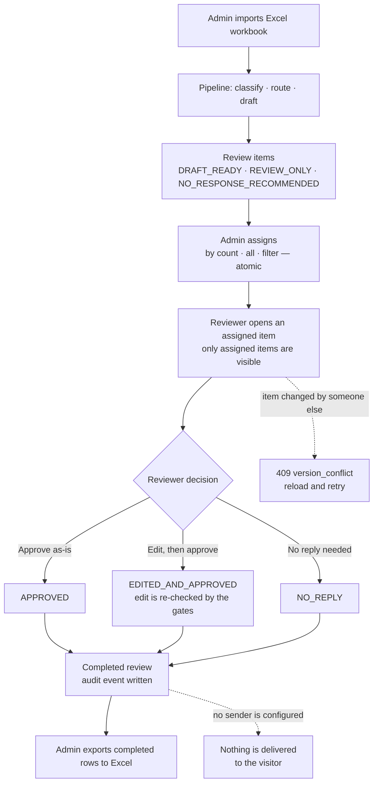

**Reviewer actions.** For a draft, a reviewer can *approve as-is*, *edit and approve*, or mark the comment *no reply needed*. There is no separate "reject" button: rejecting a draft means editing it or choosing no reply. For `REVIEW_ONLY` items there is no draft, so the reviewer writes the reply (edit and approve) or chooses no reply. A reviewer's edit passes through the same safety checks. Saves use an optimistic `row_version`; a stale save returns HTTP 409 instead of overwriting.

### Approval is not delivery

| | Reviewer approval | Actual delivery |
|---|---|---|
| What it is | A recorded decision (`APPROVED`, `EDITED_AND_APPROVED`, `NO_REPLY`) with an audit event | Posting a reply to the visitor |
| Implemented | **Yes** | **No** |
| Why | The review workflow is the product | No documented write API for visitor comments exists. `src/rcs/review/outbound.py` contains only `UnconfiguredOutboundSender`, which returns `CONNECTOR_NOT_CONFIGURED`. |

The internal action names `SEND_AS_IS` and `EDIT_AND_SEND`, and the URL paths `/send-as-is` and `/edit-and-send`, are historical: they only **record the reviewer's decision**. The service layer has a `dispatch_outbound` method and the state table has a `dispatch → SENDING → SENT` path for a future connector, but no HTTP route or background job calls it and no real sender is wired, so no code path delivers anything. Approved replies leave the system only as a completed-reviews Excel export that a person uses.

## Roles

| | ADMIN | REVIEWER |
|---|---|---|
| Import workbooks | Yes | No |
| Assign items (count / all / filter, atomic) | Yes | No |
| See items | All | **Assigned to them only** (enforced on the server) |
| Approve, edit, mark no-reply | No | Yes |
| Export completed reviews | Yes (completed only) | No |
| Analytics | Yes | No |
| Message reviewers | Yes | Receive |
| Approve or reject account requests | Yes | No |

New accounts are requested through a public form and become usable only after an admin approves them. The role is never taken from the request body.

## Analytics and reporting

Admins get a read-only analytics page, computed from fields already stored with each review item (ingest time, review time, reviewer action, status, priority, intent, topic, sentiment, reviewer). It changes nothing in the workflow.

- **Period:** today, last 7 days, this month, or a custom range.
- **Volume:** incoming comments and total human reviews in the period, and the average review time.
- **Review outcomes:** how many drafts were approved as-is, edited and approved, or marked no-reply, with shares. These describe how reviewers used the drafts; they are **not** a rating of reviewers.
- **Trend:** incoming versus reviewed comments over time.
- **Distribution:** incoming comments by intent, by topic and by sentiment. Each is an independent breakdown, not a cross-tabulation.
- **Backlog:** comments waiting for review, urgent-priority comments, and overdue comments (waiting more than 7 days).
- **Reviewer progress:** assigned, completed and remaining per reviewer, on the dashboard.
- **Reporting:** the admin exports completed reviews (completed only) to Excel.

## Tech stack

| Area | Technology |
|---|---|
| Frontend | React 18, TypeScript, Vite, Arabic RTL interface |
| Backend | Python 3.13, standard-library HTTP server, Pydantic |
| Persistence | PostgreSQL (default) via SQLAlchemy 2 and Alembic; SQLite for local use and tests; MongoDB adapter (unused) |
| Classification | scikit-learn (TF-IDF, logistic regression), PyTorch, Transformers (MARBERTv2, CAMeLBERT) |
| Reply drafts | Google Gemini via `google-genai` |
| Packaging | Docker (`python:3.13-slim`, CPU-only PyTorch, non-root user, health check) |
| Intended hosting | Vercel (frontend), AWS EC2 (backend + PostgreSQL in Docker) — planned |
| Artifact storage | Private Hugging Face repository |
| Tests | pytest, Vitest, Playwright-driven browser journeys |

## Skills demonstrated

- Arabic Natural Language Processing and multi-task text classification.
- Machine learning feature engineering, transformer inference and imbalanced-class evaluation.
- Generative AI integration with privacy, grounding and deterministic safety controls.
- Data preparation, provenance tracking, leakage analysis and reproducible evaluation.
- Full-stack development with React, TypeScript and a Python HTTP API.
- API integration, PostgreSQL schema design and database migrations.
- Docker and cloud-deployment preparation for AWS EC2 and Vercel.
- Authentication, secure sessions, role-based access control and reviewer isolation.
- Human-in-the-loop AI workflow design and auditable decisions.
- Unit, integration, security and browser testing.

## Model evaluation

> This section measures how well the three **frozen classifiers** perform on held-out data. It is unrelated to the software test results in [Testing](#testing): thousands of passing tests say nothing about classification accuracy.

Each classifier was scored once on a **sealed test split of 75 rows, of which 68 were scorable** (6 had insufficient context and 1 had no label), after the models were frozen. Training used 455 rows and model selection used 108 validation rows. The data is restricted and not distributed.

| Task | Model | Validation macro-F1 | Test macro-F1 | Test accuracy | Majority-class accuracy |
|---|---|---:|---:|---:|---:|
| Intent | TF-IDF + logistic regression | 0.315 | 0.245 | 0.412 | 0.485 (SPAM) |
| Topic | fine-tuned MARBERTv2 | 0.402 | 0.161 | 0.368 | 0.412 (OFF_TOPIC_PERSONAL) |
| Sentiment | CAMeLBERT da-sentiment (pretrained, not fine-tuned) | 0.515 | 0.364 | 0.485 | 0.574 (NEUTRAL) |

*Checked against the frozen selection record and the three test-report files.*

**Reading these numbers honestly**

- All three classifiers score **at or below the majority-class baseline** on accuracy, and test macro-F1 is lower than validation macro-F1 for every task.
- With 68 test rows and several classes with zero to five examples, per-class scores are very noisy.
- The classifiers are therefore used to **route and prioritise work for a human**, never to decide or to send anything.
- **Gemini drafts have not been rated by humans**, so no quality figure is claimed for them.
- No accuracy claim beyond the table above is made.

## Deployment architecture

**The application has not been deployed.** The diagram and the table below describe the *planned* topology and separate what exists in the repository from what does not.

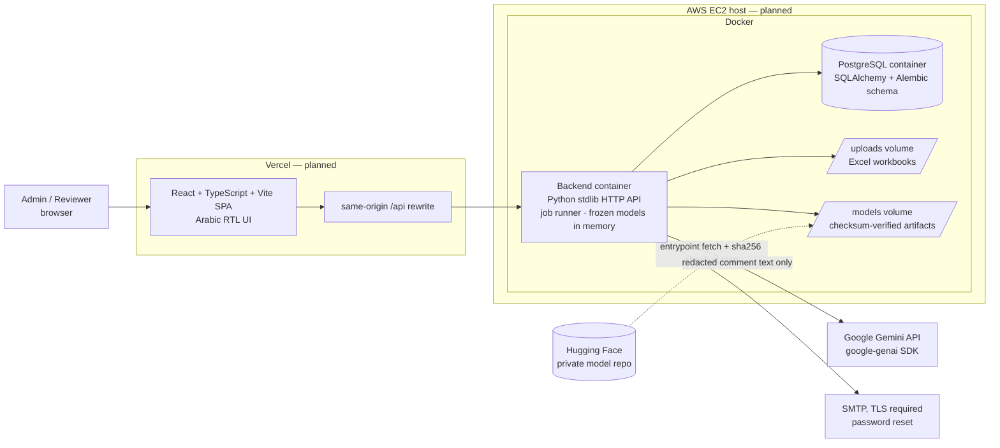

| Component | Target | State |
|---|---|---|
| Frontend (React + TypeScript + Vite) | Vercel | Deployment-ready: `web/vercel.json` and a same-origin proxy template exist. Not deployed. |
| Backend API (Python) | Docker container on AWS EC2 | Image definition ready (`Dockerfile`, `docker/entrypoint.sh`, health check `/api/health`). EC2 host: **planned**. |
| Database | PostgreSQL in a Docker container on the same EC2 host, data on a persistent volume | Schema and migrations ready. The container, volume, backups and EC2 provisioning are **planned**; the repo has no compose file or EC2 template yet. |
| Model artifacts | Private Hugging Face repository, fetched and verified at container start | Fetch and checksum verification implemented; the artifact repository is pinned in the manifest. |
| Reply drafts | Google Gemini API | Implemented; needs a `GEMINI_API_KEY` at runtime. |
| Uploads | Persistent volume (`RCS_UPLOAD_DIR`) | Implemented. |
| Live demo | — | **None.** A link will be added only after a successful deployment. |

Also in the repository as alternatives: `render.yaml` (a 2 GB single-instance backend with a persistent disk) and `Dockerfile.demo` / `render.demo.yaml` for a model-free demo mode. Neither is deployed.

Planned hardening before any real deployment: TLS in front of the API, the API container reachable only through the reverse proxy, PostgreSQL not exposed publicly, secrets supplied only as runtime environment variables, and database backups. See [production deployment notes](docs/PRODUCTION_DEPLOYMENT.md).

## Screenshots

All screenshots use **synthetic data**. They contain no visitor comments, credentials or personal information. **None of them shows production results:** the rows are invented and pre-loaded for demonstration, and the classification labels and draft replies shown are canned demo text, not output of the frozen classifiers or of Gemini.

| | |
|---|---|
| 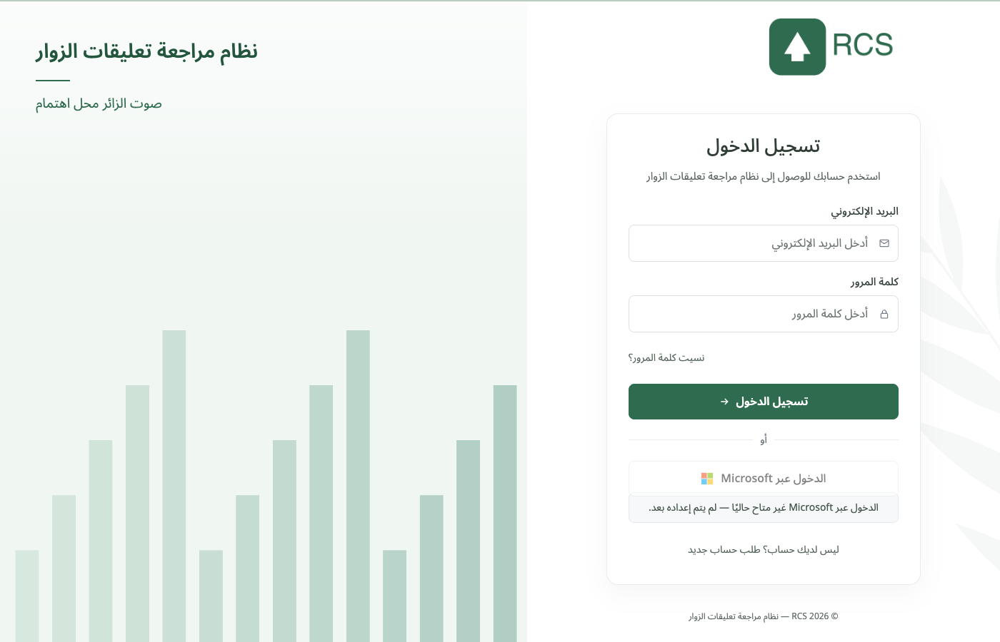<br/>**1 · Sign in** — password login; accounts are created by an admin or approved on request | 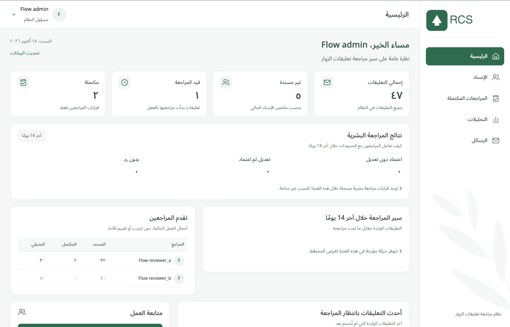<br/>**2 · Admin home** — totals, reviewer progress and queue summary |
| 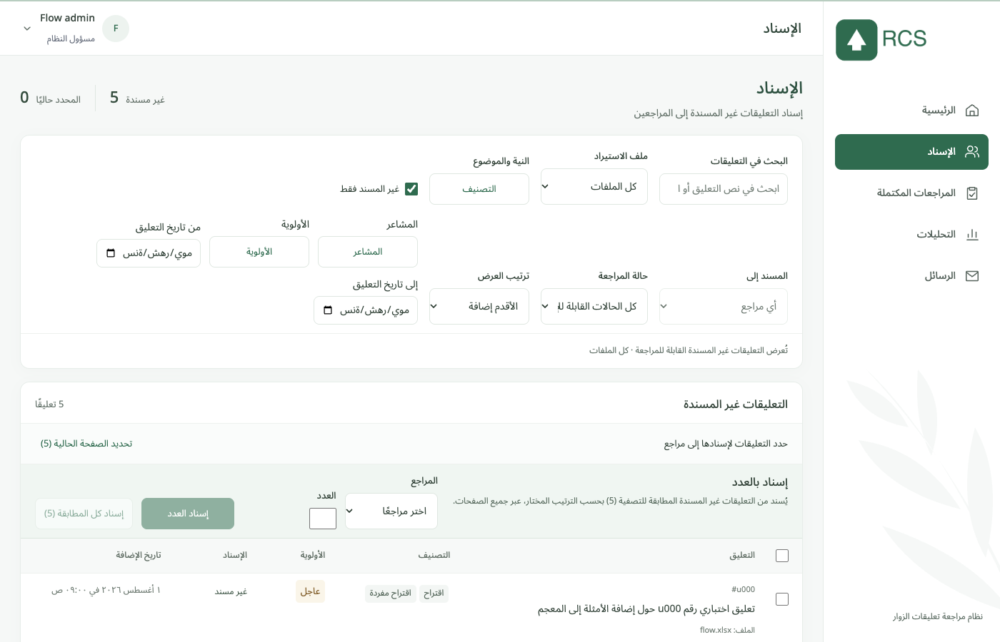<br/>**3 · Assignment** — filter, then assign by count, all matches, or a selection | 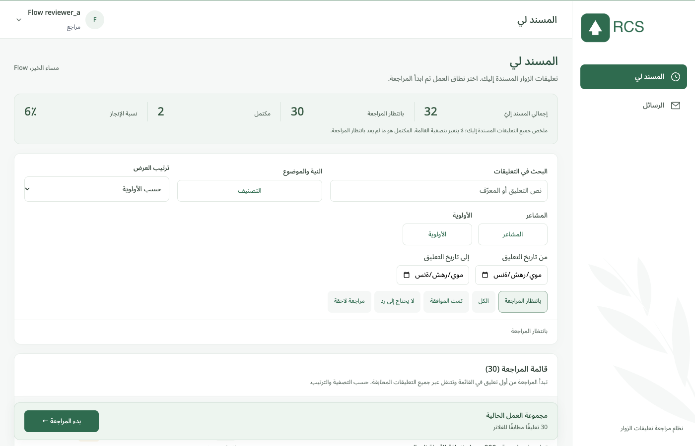<br/>**4 · Reviewer queue** — a reviewer sees only the items assigned to them |
| <br/>**5 · Review mode** — comment, classification, draft, and the three decisions | 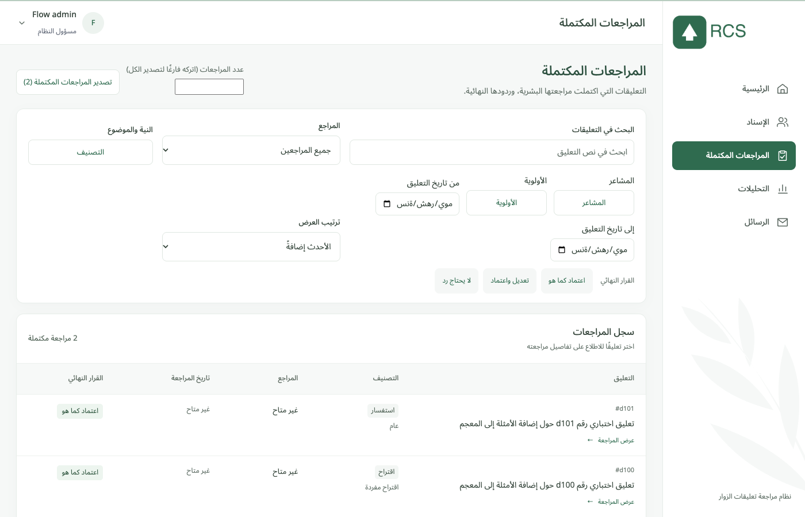<br/>**6 · Completed reviews** — final decisions, ready for export |
| 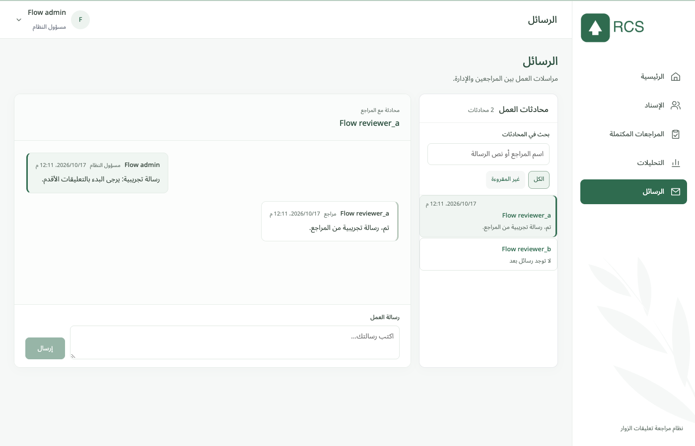<br/>**7 · Messages** — admin ↔ reviewer conversation | |

## Security and privacy

Visitor comments are personal data, so the design assumes the model provider and the repository must never see it.

| Control | Where enforced |
|---|---|
| Passwords | bcrypt |
| Sessions | Server-side; only a hash of the token is stored |
| Reset tokens | Hashed, single-use; SMTP over mandatory TLS |
| Roles and reviewer isolation | Server-side checks on every endpoint |
| Origin / content-type checks, rate limits | HTTP layer |
| Stale writes | Optimistic `row_version`, HTTP 409 |
| Data sent to Gemini | PII-redacted, untrusted-text delimited |
| Secrets | Runtime environment only; tests never read `.env` and scrub secrets from output |
| Repository contents | No visitor data, databases, model weights or credentials; secret scanning applied before publication |

More detail: [security notes](SECURITY.md).

## Testing

Software tests check that the code behaves as designed. They do **not** measure classifier accuracy; for that, see [Model evaluation](#model-evaluation).

**Verified results** (run locally; counts from the last full run):

| Suite | Result |
|---|---|
| Backend pytest, SQLite | 3168 passed, 30 skipped (private build) |
| Backend pytest, PostgreSQL 16 | 3165 passed, 33 skipped (private build) |
| Backend pytest, public build | 3040 passed, 158 skipped (tests needing private artifacts skip with a reason) |
| Frontend Vitest | 253 passed |
| TypeScript | `tsc --noEmit` clean |
| Browser journeys | Scripted admin and reviewer journeys on synthetic data |

Gemini is **mocked** in the automated suite. Skipped tests need private artifacts or services that are deliberately absent. Running the suite against PostgreSQL found and fixed a real defect: an assignment query ignored its `LIMIT` on PostgreSQL.

## Limitations

- Classifier accuracy is limited and sometimes below the majority-class baseline; labels are scarce and inconsistent. More consistent labels and an active-learning review are the planned next step.
- Reply-draft quality has not been rated by humans; live Gemini behaviour is not covered by automated tests.
- No delivery connector exists, so approved replies are not sent anywhere.
- The system has not been deployed, load-tested, or run against real traffic. The EC2 and PostgreSQL-in-Docker topology is a plan.
- MongoDB support exists in code but has never been used in production.
- Arabic only. Replies are drafts for one institution's tone and policies.

## Local setup

```bash
python3.13 -m venv .venv && source .venv/bin/activate
pip install --index-url https://download.pytorch.org/whl/cpu torch && pip install -r requirements.txt
cp .env.example .env                                   # local development only; never commit
python examples/make_synthetic_data.py && python examples/run_synthetic_evaluation.py   # training + evaluation code on synthetic data
python scripts/manage_users.py create --email admin@example.invalid --role ADMIN --name "Admin"
python scripts/serve_reviewer_api.py                   # http://127.0.0.1:8765, local SQLite
cd web && npm ci && npm run dev                        # http://localhost:5173
```

Tests: `python -m pytest -q -rs tests` · `cd web && npm test && npx tsc --noEmit && npm run build`.

`python scripts/serve_reviewer_api.py --seed` loads synthetic demo rows. A model-free demo mode is described in [docs/DEMO_MODE.md](docs/DEMO_MODE.md).

## Documentation

| Topic | Document |
|---|---|
| Architecture | [docs/ARCHITECTURE.md](docs/ARCHITECTURE.md) |
| AI/ML pipeline | [docs/AI_PIPELINE.md](docs/AI_PIPELINE.md) |
| Human-in-the-loop review | [docs/HUMAN_IN_THE_LOOP.md](docs/HUMAN_IN_THE_LOOP.md) |
| Model evaluation | [docs/ML_EVALUATION.md](docs/ML_EVALUATION.md) |
| Security and privacy | [docs/SECURITY_AND_PRIVACY.md](docs/SECURITY_AND_PRIVACY.md) · [SECURITY.md](SECURITY.md) |
| Testing | [docs/TESTING.md](docs/TESTING.md) |
| Production deployment | [docs/PRODUCTION_DEPLOYMENT.md](docs/PRODUCTION_DEPLOYMENT.md) |
| Model artifacts and data access | [docs/ARTIFACTS_AND_DATA_ACCESS.md](docs/ARTIFACTS_AND_DATA_ACCESS.md) |
| Demo mode (no weights, no LLM calls) | [docs/DEMO_MODE.md](docs/DEMO_MODE.md) · [docs/DEPLOY_DEMO.md](docs/DEPLOY_DEMO.md) |
| Persistence · authentication · password reset | [docs/persistence.md](docs/persistence.md) · [docs/authentication.md](docs/authentication.md) · [docs/password_reset.md](docs/password_reset.md) |

## License

No license has been selected; until one is added, all rights are reserved. Third-party components: [THIRD_PARTY_NOTICES.md](THIRD_PARTY_NOTICES.md).

